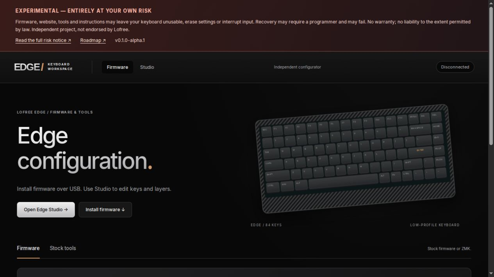
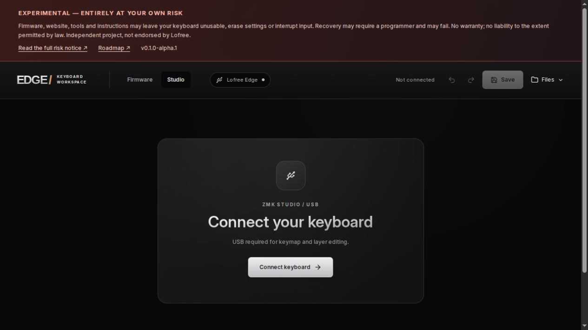

# Lofree Edge ZMK

Independent, experimental firmware and browser tools for the Lofree Edge 84-key keyboard.

> [!CAUTION]
> **USE ENTIRELY AT YOUR OWN RISK.** The firmware, website, tools and instructions may leave your keyboard unusable, erase settings, interrupt input or fail during an update. Recovery may require external programming hardware and may not succeed. Backups and retained stock firmware are **not guarantees**. No warranty or liability to the extent permitted by law. Read [the full risk notice](RISK.md) before use.

[Open browser tools](https://jc-tanedo.github.io/lofree-edge-zmk/) · [Releases](https://github.com/jc-tanedo/lofree-edge-zmk/releases) · [Get started](docs/user-guide.md) · [Roadmap](ROADMAP.md)



> Use published prerelease artifacts only. [The alpha validation record](docs/validation/v0.1.0-alpha.1.md) covers one Edge and CachyOS host; prior-build tests do not validate a newly built image.

## Why this exists

The project began with the owner's experience of limited software support for this keyboard. We wanted to extend its useful life with editable layers and configuration that does not depend on a Windows application. This describes our experience and motivation; it is not a claim that Lofree officially abandoned the product.

This is an independent project, not affiliated with or endorsed by Lofree, Telink or the ZMK project. Product names belong to their respective owners.

**AI-assisted development:** substantial code, reverse-engineering analysis, tests and documentation were produced with AI assistance. A human owner directed the work and tested a physical keyboard. This is not independent security certification or broad hardware validation. [Read the disclosure](AI_DISCLOSURE.md).

## What changes with ZMK?

| Capability | Stock firmware + our stock tools | Custom ZMK prerelease |
| --- | --- | --- |
| Ordinary typing | Supported | Physically tested on one Edge |
| Key remapping | Basic USB WebHID remapping; current map readback | USB Studio remapping with device readback |
| Layers | Built-in Fn; editable Fn tables unsupported | Three total editable layers: Base, Fn and one spare |
| Save across restart | Stock persistent mappings | Studio Save writes device storage; physically tested |
| Fn shortcuts / Caps indicator | Stock behavior | Implemented and physically tested |
| Backlight | Stock implementation | Toggle and brightness implemented; not all stock effects |
| Bluetooth input | Vendor functionality | Pairing, typing, media, Caps and reconnect physically tested |
| Wireless editing / flashing | Not supported by these tools | Not supported; Studio and flashing require USB |
| Sleep / power / physical switch | Vendor implementation, not independently characterized | Unfinished; radio mode selection uses shortcuts |
| Battery reporting | Not independently verified by this project | Placeholder; not a measured battery level |
| Recovery | Vendor behavior | Retained-image return exists; **recovery is not guaranteed** |

Known gaps and acceptance criteria are tracked in the [roadmap](ROADMAP.md). Do not infer battery life, every host OS, every Edge revision, or reliable recovery from the tests above.

## Use

Use a desktop browser exposing WebHID for the stock tools and Web Serial for Studio. Those APIs require HTTPS or localhost. OS-independent APIs do not mean every browser or OS has been physically tested.

1. Read [risks and preparation](RISK.md).
2. Follow the [illustrated user guide](docs/user-guide.md).
3. Keep a second keyboard available. Save/export your mappings before changing firmware.
4. Use only the firmware for the verified Edge hardware, and keep USB connected during updates.



<details>
<summary>Build and run locally</summary>

See [development](docs/development.md), [release procedure](docs/releasing.md) and [licensing](LICENSING.md).

```sh
python3 tools/bootstrap.py
.venv/bin/python tools/install_toolchain.py
LLVM_TOOLCHAIN_PATH="$PWD/build/toolchain23" sh tools/build_edge_zmk.sh --ble-studio
EDGE_SITE_BASE=/lofree-edge-zmk sh tools/build_edge_studio_ui.sh
.venv/bin/python tools/package_release.py --site-base /lofree-edge-zmk
```

Serve only the built website, never the repository root. Initial build prerequisites are listed in the development guide.
</details>

## Contribute and report problems

Read [contributing](CONTRIBUTING.md), [security reporting](SECURITY.md), [linked credits](ATTRIBUTION.md) and [the roadmap](ROADMAP.md). Include the release version, hardware revision if known, host OS/browser and reproducible steps. Never upload device backups, Bluetooth keys or raw captures containing private data.

Original contributions are GPL-3.0-or-later unless an existing per-file notice states otherwise. Third-party licenses remain unchanged. See [LICENSE](LICENSE), [LICENSING.md](LICENSING.md) and [third-party notices](THIRD_PARTY_NOTICES.md).
