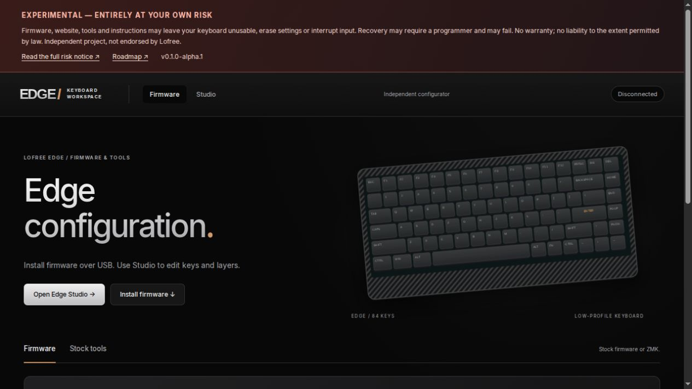
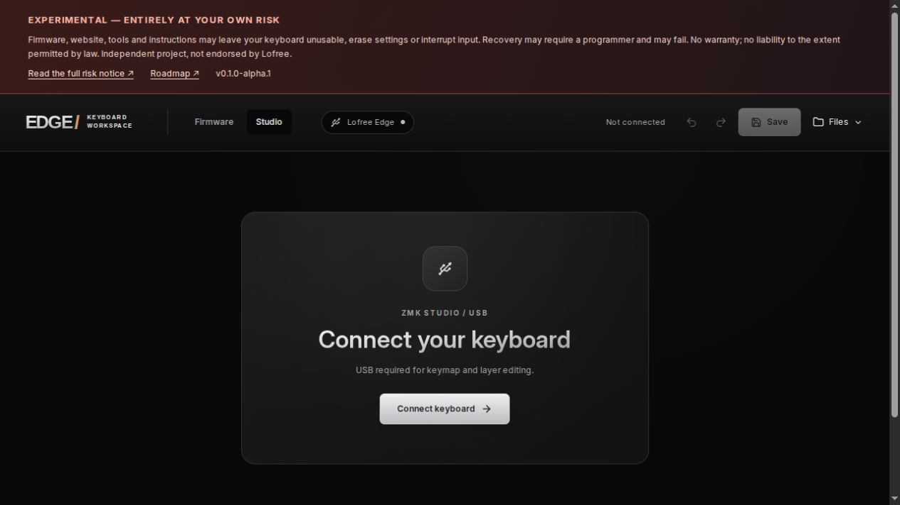
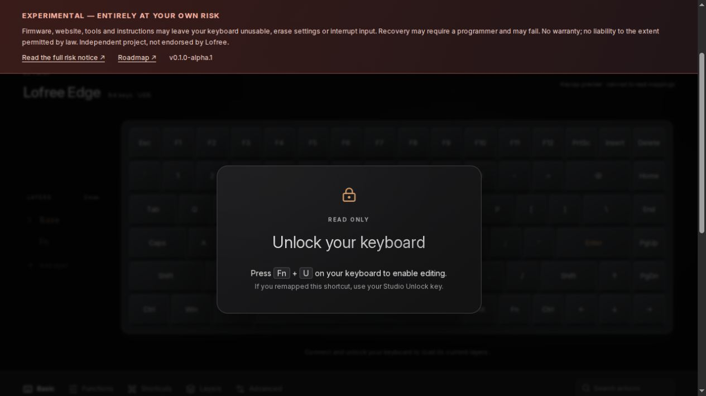
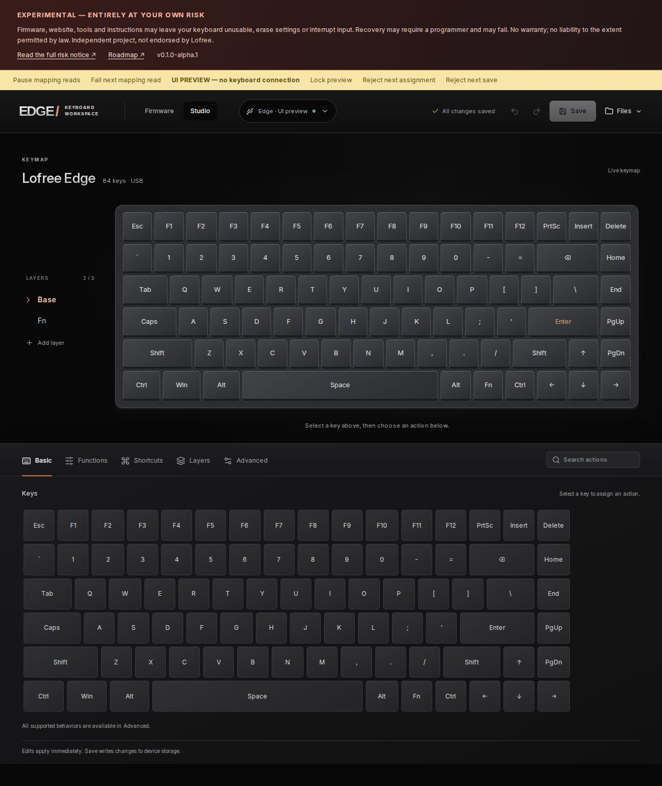

# User guide

> **EXPERIMENTAL — USE ENTIRELY AT YOUR OWN RISK.** Firmware, website, tools and instructions can make your keyboard unusable or lose settings. Recovery may require a programmer and may fail. Backups and retained stock are not guarantees. [Read the full risk notice](../RISK.md).

## Prepare

Confirm you have a Lofree Edge 84-key keyboard matching the tested hardware. Keep another keyboard available. Export your mappings before changing firmware. Use a reliable USB data cable and a desktop browser with WebHID (stock tools/flashing) and Web Serial (Studio), over HTTPS or localhost.

## Install a release



1. Read the exact [release notes](https://github.com/jc-tanedo/lofree-edge-zmk/releases), known limitations and risks. Verify the image's SHA-256.
2. If currently on ZMK, hold Fn+Space for three seconds, then release to request the retained image. This may restart the keyboard; recovery is not guaranteed.
3. In Firmware, select the matching release and connect the stock update interface in wired mode.
4. Read the installation confirmation and explicitly acknowledge the risks. Each flash requires a fresh acknowledgment.
5. Leave USB connected and the tab open until the transfer completes and the keyboard reconnects. Do not run another editor or updater concurrently.
6. Follow that release's trial/acceptance instructions. Do not assume an unconfirmed trial survives restarts. Never accept an image merely because the upload completed.

## Connect, unlock, edit and save



Open Studio in the same tab and choose Connect keyboard. Select the keyboard's USB serial interface. Studio cannot edit over Bluetooth.



Press Fn+U on the keyboard, or your remapped Studio Unlock action. The overlay blocks editing until unlocked. Skeletons remain while the keymap is read; failed reads show Retry, which reopens the USB connection and may require selecting/unlocking again.



Select a layer and key, choose its action, then **Save**. Edits take effect immediately; Save writes them to persistent storage. Three total layers are available. Use Files to export a .keymap and info.json for [Keymap Editor](https://nickcoutsos.github.io/keymap-editor/), or import the edited .keymap after reviewing its assignments. Import saves and reads back without rebuilding firmware.

## Accept a tested trial

**This writes flash and ends automatic trial rollback. Entirely at your own risk.** First verify typing, BLE, layers/save, indicators and retained-image return for the exact image. Keep the editor idle. Do not confirm an untested image or an image without a valid retained recovery slot.

The first alpha uses an explicit command-line acceptance step. Install the pinned public dependencies using the development guide. On Linux, install the system HIDAPI library as well (`libhidapi-hidraw0` on Debian/Ubuntu, `hidapi` on Arch). Use the pinned Python `hid` package, not the incompatible `hidapi` package, in a clean virtual environment. Then:

```sh
.venv/bin/python -m pip install -r requirements-device.lock
.venv/bin/python tools/edge_ota.py info
.venv/bin/python tools/edge_ota.py confirm --accept-risk
```

Confirm runs the upstream flash self-test and boot guard checks. A refused self-test is a stop condition, not a reason to bypass the guard. Linux USB access may require the included udev rule and reconnecting the keyboard. Manual retained-image return remains available only while that image and recovery path are valid; it is not a guarantee.

## Connection shortcuts

Fn+4 selects USB output; Fn+5 selects Bluetooth output. Fn+1/2/3 select Bluetooth profiles, and Fn+Backspace clears the current profile. Actual battery level, sleep and physical mode-switch handling are unfinished. See [roadmap](../ROADMAP.md).

## Recovery

**Recovery is at your own risk and is not guaranteed.** Stop other device tools first. A valid retained image may be requested with Fn+Space held for three seconds and released. If USB is unavailable, stop repeated flashing attempts. External programming hardware or disassembly may be required; this project does not ship stock repair images. Do not use historical probe/repair scripts from an investigation workspace.

## Troubleshooting and reporting

For a failed read, check USB and Retry. For an interrupted flash, record the release/hash and last acknowledged block, keep the updater idle and check ordinary typing after a controlled reconnect. Do not assume success or start another flash blindly. Report sanitized observations through [issues](https://github.com/jc-tanedo/lofree-edge-zmk/issues), never a raw flash dump or bond keys.
